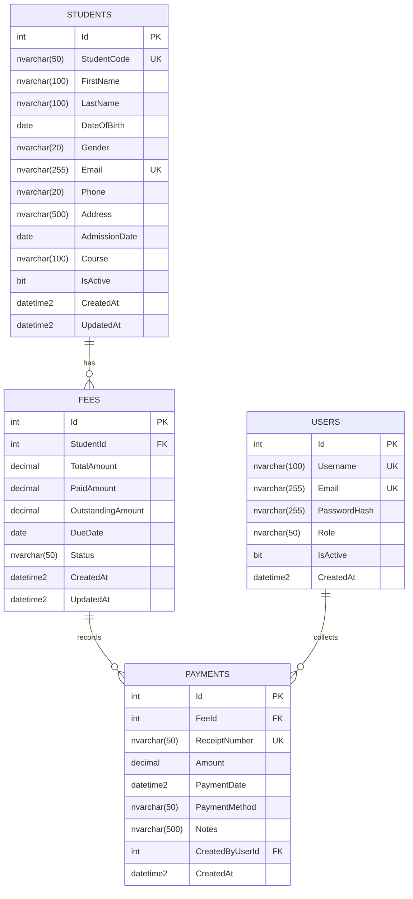

# Student Management Mini-ERP

A production-style, web-based **Student Management Mini-ERP** built with **React (Vite)**, **ASP.NET Core 9 Web API**, **Entity Framework Core 9**, and **Microsoft SQL Server**.

Developed as an AI-assisted full-stack development assessment project demonstrating clean architecture, strict database integrity, financial transaction safety, responsive UI, role-based security, and extensibility.

---

## 1. Project Overview & Capabilities

The system allows educational institution administrators and staff members to manage the complete student lifecycle and fee payment collections:

1. **Executive Dashboard**: Real-time KPI summary (total students, active/inactive counts, total billed, total collected, total outstanding) + recent payment & admission feeds.
2. **Student Admission**: Registration workflow with auto-generated student codes (`STU-YYYY-XXXXX`), format validations, duplicate checks, and course assignment.
3. **Student Directory & Lifecycle**:
   - Server-side search by name, student code, email, or phone.
   - Server-side filtering by course and enrollment status (Active / Inactive).
   - Server-side pagination with configurable page size.
   - Profile view with comprehensive demographic details, associated fee records, and payment history.
   - Profile editing with validation.
   - Soft deactivation/activation toggle (preserving academic & audit history).
4. **Fee Management & Ledger**:
   - Course fee allocation with due date tracking.
   - Status tracking (`Pending`, `Partial`, `Paid`, `Overdue`).
   - ACID-compliant partial and full payment transactions.
   - Overpayment rejection guard (`amount <= remainingBalance`).
   - Automated sequential receipt number generation (`REC-YYYY-XXXXXX`).
5. **Change Request (CR-01)**:
   - **Printable Receipts**: Formal institutional fee receipts with `@media print` CSS layout and direct browser print trigger.
   - **CSV Export**: Server-side CSV streaming export for student directory and financial reporting.
6. **Authentication & Security**:
   - JWT Bearer token authentication with role-based authorization (`Admin` vs `Staff`).
   - BCrypt password hashing.
   - Protected API routes and client-side route guards.
   - Centralized global exception envelope (`ApiResponse<T>`).

---

## 2. Technology Stack

### Frontend
- **Framework**: React 18 (Functional Components, Hooks)
- **Tooling**: Vite 6
- **Routing**: React Router DOM v6
- **HTTP Client**: Axios (with Bearer token interceptor and 401 redirect)
- **Icons**: Lucide React
- **Styling**: Enterprise Custom CSS Design System (Responsive, Modern Dashboard, Print CSS)

### Backend
- **Framework**: ASP.NET Core 9.0 Web API
- **Language**: C# 13 / .NET 9
- **ORM**: Entity Framework Core 9.0
- **Database Provider**: Microsoft SQL Server
- **Authentication**: JWT Bearer (`Microsoft.AspNetCore.Authentication.JwtBearer`)
- **Password Security**: BCrypt.Net-Next (Work factor 11)
- **API Documentation**: Swashbuckle Swagger / OpenAPI 3.0

### Database
- **Engine**: Microsoft SQL Server 2019/2022 / Express / Developer Edition
- **Integrity**: Primary Keys, Foreign Keys (`DeleteBehavior.Restrict`), Unique Indexes, Check Constraints
- **Precision**: `decimal(18,2)` for all monetary fields

---

## 3. Architecture & Design Principles

### 3-Tier Layered Architecture

```
┌────────────────────────────────────────────────────────┐
│             React Single Page Application              │
│       (Pages, Context, Modals, Axios Interceptors)      │
└───────────────────────────┬────────────────────────────┘
                            │ HTTP / JSON (JWT Bearer)
┌───────────────────────────▼────────────────────────────┐
│              ASP.NET Core 9 Web API                    │
│                                                        │
│  Controllers  ──►  Services (Business Logic)           │
│       │                      │                         │
│  DTO Validation         ACID Transactions              │
│       │                      │                         │
│  Exception Middleware   EF Core DbContext              │
└───────────────────────────┬────────────────────────────┘
                            │ ADO.NET / TDS Protocol
┌───────────────────────────▼────────────────────────────┐
│               Microsoft SQL Server                     │
│  [Users]  ──  [Students]  ◄──►  [Fees]  ◄──► [Payments]│
└────────────────────────────────────────────────────────┘
```

### Key Engineering Decisions
- **No Over-Engineering**: Adheres to pragmatic layered architecture (Controllers -> Services -> EF Core DbContext) instead of unnecessary CQRS/Microservices complexity for this scope.
- **Financial Transaction Safety**: Payments use `IDbContextTransaction` to ensure atomicity. If a payment exceeds the outstanding balance, the transaction rolls back immediately and returns HTTP 400.
- **No Cascade Deletes (`DeleteBehavior.Restrict`)**: Prevents accidental data deletion. Students and fees with financial records cannot be physically removed; soft deactivation is enforced.
- **Currency Precision**: All amounts use `decimal(18,2)` to avoid floating-point rounding errors.

---

## 4. Database Schema & Relationships



---

## 5. API Reference Summary

### Authentication (`/api/auth`)
| Method | Endpoint | Access | Description |
|---|---|---|---|
| `POST` | `/api/auth/login` | Public | Authenticates credentials, returns JWT & user profile |
| `GET` | `/api/auth/me` | Authenticated | Returns current authenticated user |

### Students (`/api/students`)
| Method | Endpoint | Access | Description |
|---|---|---|---|
| `GET` | `/api/students` | Authenticated | Paginated, filtered, searchable student directory |
| `GET` | `/api/students/{id}` | Authenticated | Detailed student profile with fees & payment history |
| `POST` | `/api/students` | Admin | Registers new student, auto-generates code |
| `PUT` | `/api/students/{id}` | Admin | Updates student demographic details |
| `PATCH` | `/api/students/{id}/toggle-status` | Admin | Toggles active / inactive status (soft deactivation) |
| `GET` | `/api/students/export` | Authenticated | Streams student list as CSV file |

### Fees & Payments (`/api/fees`)
| Method | Endpoint | Access | Description |
|---|---|---|---|
| `GET` | `/api/fees` | Authenticated | Retrieves all fee records |
| `GET` | `/api/fees/student/{studentId}` | Authenticated | Retrieves fees for a specific student |
| `POST` | `/api/fees` | Admin | Allocates a new fee to a student |
| `POST` | `/api/fees/{feeId}/payments` | Authenticated | Records payment with ACID transaction & receipt |
| `GET` | `/api/fees/receipts/{receiptNumber}` | Authenticated | Retrieves printable receipt details |

### Dashboard (`/api/dashboard`)
| Method | Endpoint | Access | Description |
|---|---|---|---|
| `GET` | `/api/dashboard/summary` | Authenticated | Returns aggregated KPI cards, recent feeds |

---

## 6. Getting Started & Installation

### Prerequisites
- .NET 9 SDK
- Node.js (v18+ or v22+) & npm
- Microsoft SQL Server (LocalDB, Express, or Developer instance)

### 1. Database Setup
Execute the SQL creation scripts in SQL Server Management Studio (SSMS) or via sqlcmd:
```powershell
sqlcmd -S localhost -E -i database/create-database.sql
sqlcmd -S localhost -E -i database/seed-data.sql
```
*Note: The backend automatically seeds and verifies accounts on first launch via `DbInitializer.cs`.*

### 2. Backend Setup
```powershell
cd backend/StudentManagement.Api
dotnet restore
dotnet run
```
Backend runs at `http://localhost:5000` (Swagger UI at `http://localhost:5000/swagger`).

### 3. Frontend Setup
```powershell
cd frontend
npm install
npm run dev
```
Frontend runs at `http://localhost:5173`.

---

## 7. Demo Credentials

| Role | Username | Password | Permissions |
|---|---|---|---|
| **Admin** | `admin` | `Admin@123` | Full access: Admission, Edit, Deactivate, Fee allocation, Payments, Dashboard, CSV Export |
| **Staff** | `staff` | `Staff@123` | Operational access: View Students, Record Payments, View Dashboard, View Receipts |

---

## 8. Technical Interview & Defense Q&A

### Q1: Why did you choose ASP.NET Core Web API with EF Core?
**Answer**: ASP.NET Core 9 provides high throughput, compile-time type safety, enterprise-grade dependency injection, and native middleware pipelines. EF Core 9 enables structured LINQ queries, migration tracking, and transaction management (`IDbContextTransaction`) while allowing fine-grained control over SQL execution and relationship cascade behavior.

### Q2: How does the system guarantee financial transaction integrity?
**Answer**: In `FeeService.RecordPaymentAsync`, payments are executed inside an `IDbContextTransaction`. The fee record is loaded, the positive amount is validated, and the system verifies `payment.Amount <= fee.OutstandingAmount`. The payment record is inserted, the fee balance is decremented, the status updated, a unique receipt number generated, and `SaveChangesAsync()` called. If any step fails or an exception occurs, the transaction is automatically rolled back, leaving zero orphaned payments or corrupted balances.

### Q3: Why is soft deactivation used instead of physical DELETE?
**Answer**: In educational ERPs, students have historical enrollment records, fee allocations, and payment receipts. Physical deletion violates foreign key constraints (`DeleteBehavior.Restrict`) and destroys financial audit trails. Setting `IsActive = false` preserves all relational history while filtering them out of active operational views.

### Q4: How is server-side pagination and filtering implemented?
**Answer**: The client sends `page`, `pageSize`, `search`, `course`, and `status`. The service builds an `IQueryable<Student>` pipeline. Filtering (`Where`) and search conditions are applied on the server before `CountAsync()` retrieves the total filtered count. `Skip((page - 1) * pageSize).Take(pageSize)` translates directly to SQL Server `OFFSET ... FETCH NEXT` clauses, ensuring minimal memory footprint regardless of database size.

### Q5: How was the Change Request (CR-01) handled?
**Answer**: CR-01 requested printable receipts and CSV export. For printable receipts, we created a specialized `ReceiptModal` with `@media print` CSS rules that hides navigation shells and displays a clean institutional receipt layout triggering `window.print()`. For CSV export, an endpoint `/api/students/export` streams structured CSV data directly as `text/csv`, with a one-click download button integrated on the frontend dashboard and student directory.
