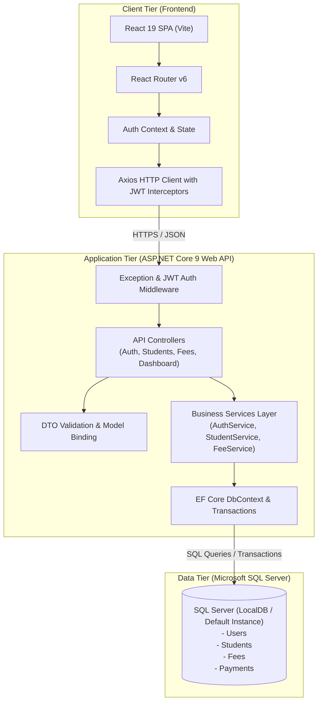

# Student Management Mini-ERP — System Architecture & Design Specification

## 1. Requirement Analysis
The objective is to deliver a robust, production-style, but appropriately scoped Student Management Mini-ERP for managing student admissions, status lifecycles, and academic fee collection with partial payments and receipts.

### Key Functional Capabilities:
- **Authentication & Security:** Secure JWT-based authentication for Admin and Staff roles with BCrypt password hashing.
- **Student Lifecycle Management:** Unique code generation (`STU-YYYY-XXXXX`), demographic data capture, courses, soft deactivation (`IsActive`), detailed student profile view.
- **Search, Filtering & Pagination:** Server-side search across Student Code, Name, Email; filtering by Course and Status; indexed database pagination (`page`, `pageSize`, `totalItems`, `totalPages`).
- **Fee Management & Financial Safety:** Total fee assignment, partial payments recording, automatic outstanding balance computation (`Outstanding = Total - Paid`), unique receipt generation (`REC-YYYY-XXXXXX`), atomic database transactions ensuring ACID compliance and eliminating overpayment risks.
- **Executive Dashboard:** Aggregated KPI cards (Total, Active, Inactive Students, Total Fees, Collected, Outstanding) calculated live via database queries.

---

## 2. Functional Module Breakdown
1. **Module 1: Infrastructure & Auth Module**
   - JWT token generation & validation middleware
   - Role-based authorization (`Admin`, `Staff`)
   - Global exception handling middleware & uniform API error response envelope
2. **Module 2: Student Management Module**
   - Admission (Create) with unique `StudentCode` validation
   - Update, View Details, Soft Deactivate
   - Server-side Search, Filtering, and Pagination
3. **Module 3: Fee & Payment Transaction Module**
   - Fee record generation per student
   - Payment entry with ACID transaction lock, overpayment rejection, receipt issuance
   - Payment audit trail and receipt retrieval
4. **Module 4: Dashboard & Analytics Module**
   - Aggregated metrics and financial collection stats
5. **Module 5: React Single Page Application (SPA)**
   - Router, Auth Context with JWT handling & Route guards
   - Clean Admin layout with Sidebar, Topbar, Data Tables, Modal dialogues, and responsive design

---

## 3. Proposed Architecture
A classic layered architecture prioritizing testability, separation of concerns, and clean boundaries:
- **Presentation Layer:** React (Vite) SPA + React Router + Axios Interceptors + Tailwind/Custom CSS.
- **API / Controller Layer:** ASP.NET Core Web API 9.0 Controllers, route definitions, parameter validation.
- **Service / Business Logic Layer:** `IStudentService`, `IFeeService`, `IAuthService`, `IDashboardService` holding business rules.
- **Data Access Layer:** Entity Framework Core with SQL Server provider, Fluent API mappings, DB Context, transactions.
- **Database:** Microsoft SQL Server with strict foreign keys, check constraints, unique indexes, and `decimal(18,2)` financial precision.

---

## 4. Project & Folder Structure

```text
student-management-mini-erp/
│
├── backend/
│   ├── StudentManagement.Api/
│   │   ├── Controllers/
│   │   │   ├── AuthController.cs
│   │   │   ├── StudentsController.cs
│   │   │   ├── FeesController.cs
│   │   │   └── DashboardController.cs
│   │   ├── Data/
│   │   │   ├── ApplicationDbContext.cs
│   │   │   └── DbInitializer.cs
│   │   ├── Entities/
│   │   │   ├── User.cs
│   │   │   ├── Student.cs
│   │   │   ├── Fee.cs
│   │   │   └── Payment.cs
│   │   ├── DTOs/
│   │   │   ├── Auth/
│   │   │   ├── Students/
│   │   │   ├── Fees/
│   │   │   ├── Common/
│   │   │   └── Dashboard/
│   │   ├── Services/
│   │   │   ├── Interfaces/
│   │   │   └── Implementations/
│   │   ├── Middleware/
│   │   │   └── ExceptionHandlingMiddleware.cs
│   │   ├── appsettings.json
│   │   └── Program.cs
│   └── StudentManagement.Tests/
│
├── frontend/
│   ├── public/
│   ├── src/
│   │   ├── api/
│   │   │   ├── apiClient.js
│   │   │   ├── authApi.js
│   │   │   ├── studentApi.js
│   │   │   ├── feeApi.js
│   │   │   └── dashboardApi.js
│   │   ├── components/
│   │   │   ├── common/ (Navbar, Sidebar, DataTable, Pagination, Modal, Alert)
│   │   │   └── layout/ (AppLayout, ProtectedRoute)
│   │   ├── context/
│   │   │   └── AuthContext.jsx
│   │   ├── pages/
│   │   │   ├── Login.jsx
│   │   │   ├── Dashboard.jsx
│   │   │   ├── Students/ (StudentList, StudentCreate, StudentEdit, StudentDetail)
│   │   │   └── Fees/ (FeeList, FeeDetail, PaymentModal)
│   │   ├── App.jsx
│   │   ├── main.jsx
│   │   └── index.css
│   ├── package.json
│   └── vite.config.js
│
├── database/
│   ├── create-database.sql
│   └── seed-data.sql
│
├── docs/
│   ├── architecture.md
│   ├── database.md
│   ├── api.md
│   └── testing.md
│
└── README.md
```

---

## 5. Mermaid Architecture Diagram


