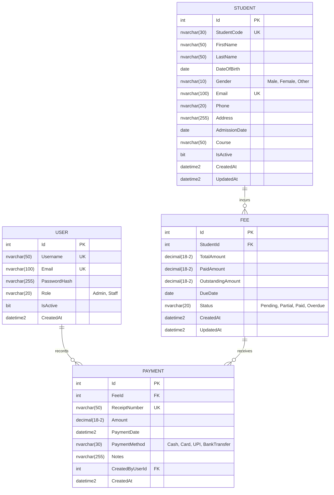

# Database Design Specification

## 1. Relational ER Diagram

---

## 2. Entity Definitions & Field Details

### 2.1 User
- `Id`: `INT IDENTITY(1,1) PRIMARY KEY`
- `Username`: `NVARCHAR(50) NOT NULL UNIQUE`
- `Email`: `NVARCHAR(100) NOT NULL UNIQUE`
- `PasswordHash`: `NVARCHAR(255) NOT NULL` (BCrypt hash)
- `Role`: `NVARCHAR(20) NOT NULL` (`Admin` or `Staff`)
- `IsActive`: `BIT NOT NULL DEFAULT 1`
- `CreatedAt`: `DATETIME2 NOT NULL DEFAULT SYSUTCDATETIME()`

### 2.2 Student
- `Id`: `INT IDENTITY(1,1) PRIMARY KEY`
- `StudentCode`: `NVARCHAR(30) NOT NULL UNIQUE` (Format: `STU-YYYY-XXXXX`)
- `FirstName`: `NVARCHAR(50) NOT NULL`
- `LastName`: `NVARCHAR(50) NOT NULL`
- `DateOfBirth`: `DATE NOT NULL`
- `Gender`: `NVARCHAR(10) NOT NULL`
- `Email`: `NVARCHAR(100) NOT NULL UNIQUE`
- `Phone`: `NVARCHAR(20) NOT NULL`
- `Address`: `NVARCHAR(255) NULL`
- `AdmissionDate`: `DATE NOT NULL`
- `Course`: `NVARCHAR(50) NOT NULL`
- `IsActive`: `BIT NOT NULL DEFAULT 1` (Soft-deactivation flag)
- `CreatedAt`: `DATETIME2 NOT NULL DEFAULT SYSUTCDATETIME()`
- `UpdatedAt`: `DATETIME2 NULL`

### 2.3 Fee
- `Id`: `INT IDENTITY(1,1) PRIMARY KEY`
- `StudentId`: `INT NOT NULL FOREIGN KEY REFERENCES Student(Id) ON DELETE RESTRICT`
- `TotalAmount`: `DECIMAL(18,2) NOT NULL CHECK (TotalAmount >= 0)`
- `PaidAmount`: `DECIMAL(18,2) NOT NULL DEFAULT 0.00 CHECK (PaidAmount >= 0)`
- `OutstandingAmount`: `DECIMAL(18,2) NOT NULL CHECK (OutstandingAmount >= 0)`
- `DueDate`: `DATE NOT NULL`
- `Status`: `NVARCHAR(20) NOT NULL` (`Pending`, `Partial`, `Paid`, `Overdue`)
- `CreatedAt`: `DATETIME2 NOT NULL DEFAULT SYSUTCDATETIME()`
- `UpdatedAt`: `DATETIME2 NULL`

### 2.4 Payment
- `Id`: `INT IDENTITY(1,1) PRIMARY KEY`
- `FeeId`: `INT NOT NULL FOREIGN KEY REFERENCES Fee(Id) ON DELETE RESTRICT`
- `ReceiptNumber`: `NVARCHAR(50) NOT NULL UNIQUE` (Format: `REC-YYYY-XXXXXX`)
- `Amount`: `DECIMAL(18,2) NOT NULL CHECK (Amount > 0)`
- `PaymentDate`: `DATETIME2 NOT NULL DEFAULT SYSUTCDATETIME()`
- `PaymentMethod`: `NVARCHAR(30) NOT NULL` (`Cash`, `Card`, `UPI`, `Bank Transfer`)
- `Notes`: `NVARCHAR(255) NULL`
- `CreatedByUserId`: `INT NOT NULL FOREIGN KEY REFERENCES User(Id) ON DELETE RESTRICT`
- `CreatedAt`: `DATETIME2 NOT NULL DEFAULT SYSUTCDATETIME()`

---

## 3. Database Constraints & Integrity Rules
1. **Primary & Foreign Keys:** Strict relationships preventing orphan fees or payments. `ON DELETE RESTRICT` prevents accidental cascade deletion of financial records.
2. **Unique Constraints:**
   - `Student(StudentCode)`
   - `Student(Email)`
   - `User(Username)`
   - `User(Email)`
   - `Payment(ReceiptNumber)`
3. **Check Constraints:**
   - `TotalAmount >= 0`
   - `PaidAmount >= 0`
   - `PaidAmount <= TotalAmount`
   - `OutstandingAmount = TotalAmount - PaidAmount`
   - `Payment.Amount > 0`
4. **Indexes:**
   - `IX_Student_StudentCode` (Unique)
   - `IX_Student_Email` (Unique)
   - `IX_Student_LastName_FirstName` (Composite index for search)
   - `IX_Student_Course_IsActive` (Composite index for filtering)
   - `IX_Fee_StudentId`
   - `IX_Payment_FeeId`
   - `IX_Payment_ReceiptNumber` (Unique)

---

## 4. Financial Transaction Safety (ACID)
When a payment is processed:
1. Begin explicit `IDbContextTransaction`.
2. Fetch Fee record by `FeeId` with an exclusive update lock.
3. Validate:
   - `Amount > 0`
   - `Amount <= Fee.OutstandingAmount`
4. Calculate new balances:
   - `Fee.PaidAmount += Amount`
   - `Fee.OutstandingAmount = Fee.TotalAmount - Fee.PaidAmount`
   - `Fee.Status = (Fee.OutstandingAmount == 0) ? "Paid" : "Partial"`
   - `Fee.UpdatedAt = DateTime.UtcNow`
5. Generate cryptographically safe receipt sequence: `REC-{DateTime.UtcNow.Year}-{counter:D6}`.
6. Insert `Payment` record.
7. Save changes and commit transaction.
8. If any exception occurs, automatic rollback restores previous database state without inconsistencies.
